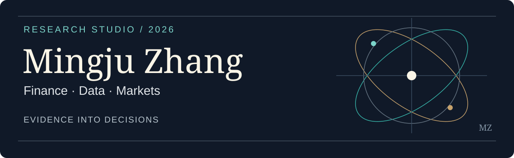

# Research Directory

**Mingju Zhang · Columbia Business School MSFE ’27**  
[Profile](https://github.com/Mingju-Zhang-CBS) · [LinkedIn](https://www.linkedin.com/in/mingju-zhang-611b00223/)

I build testable research systems that connect financial evidence, models and decisions. Seven connected studies explore financial data, signals, valuation and implementation. Each provides code, methods, tests, recorded results and limitations; the data classification belongs to each experiment rather than the repository as a whole.

## Three flagship questions

**01 / [Financial ML Validation](https://github.com/Mingju-Zhang-CBS/financial-ml-validation)**  
When does a model deserve to be trusted? Purged comparison, historical stock selection and training-only regularization. Public Treasury observations; licensed equity workflow and a separate synthetic fixture.  
[Treasury findings](https://github.com/Mingju-Zhang-CBS/financial-ml-validation/blob/main/reports/real/REPORT.md) · [Equity methods](https://github.com/Mingju-Zhang-CBS/financial-ml-validation/blob/main/docs/EQUITY_RESEARCH.md)

**02 / [Derivatives Pricing Lab](https://github.com/Mingju-Zhang-CBS/derivatives-pricing-lab)**  
What separates a correct formula from a useful valuation? Numerical checks, Greeks, simulation and contract conventions. Deterministic grid and synthetic examples; licensed SPX results private.  
[QuantLib comparison](https://github.com/Mingju-Zhang-CBS/derivatives-pricing-lab/blob/main/reports/quantlib/REPORT.md) · [Quote methods](https://github.com/Mingju-Zhang-CBS/derivatives-pricing-lab/blob/main/docs/QUOTE_RESEARCH.md)

**03 / [Market Making Lab](https://github.com/Mingju-Zhang-CBS/market-making-lab)**  
Who still trades when the quote becomes wider? Conditional value, price-sensitive fills, inventory and adverse selection. Predetermined simulated scenarios, shared paths and explicit cash accounting.  
[Demand experiment](https://github.com/Mingju-Zhang-CBS/market-making-lab/blob/main/reports/demand/REPORT.md)

**Research chain:** observation & identity → information set → signal or valuation → validation → implementation & risk.

## Complete study collection

- [Financial ML Validation](projects/financial-ml-validation.md) — baseline judgment and historical equity validation; public Treasury data, licensed equity inputs, separate fixture.
- [Derivatives Pricing Lab](projects/derivatives-pricing-lab.md) — numerical correctness and quote conventions; grid/simulation public, licensed SPX results private.
- [Market Making Lab](projects/market-making-lab.md) — customer choice, fills and inventory risk; assumed simulated demand.
- [Financial Text Validation](projects/financial-text-validation.md) — 128 public FOMC statements and archived FX references; incremental text value unproven.
- [Systematic Strategy Lab](projects/systematic-strategy-lab.md) — official fund NAVs and modeled allocations; confirmation momentum advantage unproven. The [paired commodity retirement study](https://github.com/Mingju-Zhang-CBS/systematic-strategy-lab/blob/main/docs/COMMODITY_STAGED_EXITS.md) diagnoses old legs, stages capacity-limited reductions and tests a frozen early-exit rule; previous baselines remain available. Public demonstrations are synthetic and licensed futures findings stay private.
- [Agentic Quant Research](projects/agentic-quant-research.md) — synthetic offline JSON controller; no live LLM or Qlib integration claimed.
- [Defined-Outcome Research](projects/defined-outcome-research.md) — issuer facts and model scenarios; payoff, interim value and observed quote distinguished.

## Research map

These notes recover methods from earlier learning and experience; they are not additional empirical projects or redistributed course submissions.

- [Equity signals: risk adjustment, events and regularization](cases/equity-signal-research.md)
- [Financial data: identity, units and availability](cases/financial-data-engineering.md)
- [Financial text: raw-to-derived checks and event clocks](cases/financial-text.md)
- [Statistical learning foundations](cases/statistical-learning-foundations.md)
- [Trading and inventory risk](cases/trading-market-making.md)
- [Products and portfolio decisions](cases/products-portfolio.md)
- [Housing and credit](cases/housing-credit.md) · [Research systems](cases/research-systems.md)

## Reproduction & attribution

Start with a study README, then its methods, results and test directory. Default examples use lawful bundled inputs or simulation. CRSP and OptionMetrics workflows require the reader's own institutional access; original records and restricted derived outputs are excluded. Access does not imply redistribution rights. Historical splits do not create prospective unseen evidence from previously studied periods.

Mingju Zhang selected the portfolio questions and direction. Implementation, experiment design, tests and writing were AI-assisted; source coursework, collaborators, established methods and library authors retain their separate attribution. A recorded automated run does not establish unaided human mastery. Original employer, competition and group materials stay private.

[Canonical content catalog](project-catalog.json) · [Evidence standards](docs/EVIDENCE_STANDARD.md)
