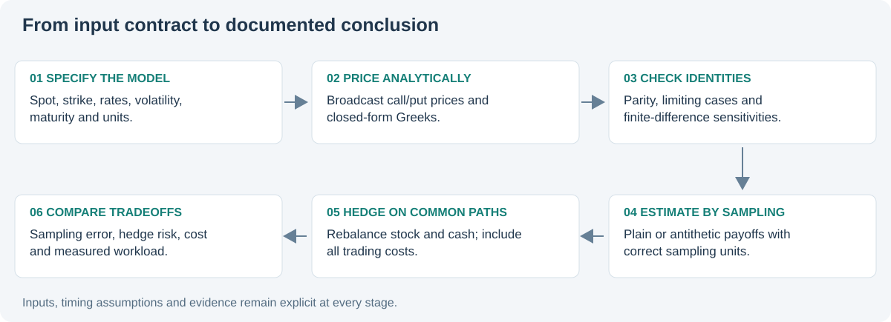

# Derivatives Pricing Lab

[Source repository](https://github.com/Mingju-Zhang-CBS/derivatives-pricing-lab) · [Methods](https://github.com/Mingju-Zhang-CBS/derivatives-pricing-lab/blob/main/docs/METHODS.md) · [Tests and offline demo](https://github.com/Mingju-Zhang-CBS/derivatives-pricing-lab/actions/workflows/checks.yml)

**Question:** How do valuation accuracy, simulation uncertainty and hedge costs interact?

## Contribution and skills

An independent implementation connects Black-Scholes-Merton prices and analytical Greeks to terminal Monte Carlo and a self-financing short-option hedge. It demonstrates mathematical finance, numerical identities, variance estimation, simulation design and declared performance measurement.

## The recorded experiment

With S=K=100, r=3%, volatility=20%, maturity one year and no dividends, the analytical call price is 9.413403. At 200,000 terminal paths, antithetic sampling lowers estimated standard error from approximately 0.031761 to 0.023705, or 25.4%. Its realized point error is nevertheless larger for this seed: lower sampling variance does not guarantee that every draw is closer to the truth.

The hedge study compares 12, 63 and 252 rebalances with 0, 5 and 10 bps costs across 6,000 common stock paths. Frictionless P&L standard deviation falls from about 1.9222 at 12 rebalances to 0.4430 at 252. With costs, frequent trading lowers mean hedge P&L.

## The numerical choices that matter

An antithetic pair mean is one independent observation; 200,000 terminal paths yield 100,000 pair observations. Batch means and centered second moments avoid retaining every payoff while preserving the variance calculation.

Selling an option funds a delta-stock position plus a cash balance. Cash accrues interest; each rebalance changes stock and cash; final liquidation and payoff settlement are explicit. The simulation uses a common finest grid so comparisons share terminal stock outcomes.

## Verification and limits

The packet tests parity, known prices, finite-difference Greeks, pair-level uncertainty, invalid simulation inputs and one-step hedge accounting. A runnable worked example explains Greek units and the financed hedge cash flow.

The model assumes constant-volatility GBM and zero dividends for hedging. It excludes jumps, stochastic volatility, margin, impact and financing spreads. A seven-run batch benchmark measures 10,000 local option valuations; it is not exchange latency or a production guarantee.

[Recorded metrics](../assets/derivatives-pricing-lab-metrics.json) · [Run manifest](../assets/derivatives-pricing-lab-manifest.json)

The complete implementation is published in [`derivatives-pricing-lab`](https://github.com/Mingju-Zhang-CBS/derivatives-pricing-lab). Public outputs are simulated and development was AI-assisted. The original mathematical model retains attribution.
