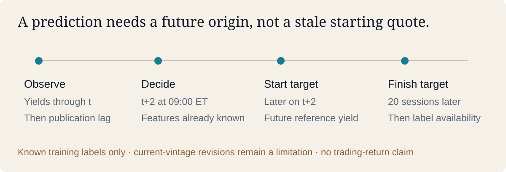

# Financial ML Validation

[Code](https://github.com/Mingju-Zhang-CBS/financial-ml-validation) · [Full real-data report](https://github.com/Mingju-Zhang-CBS/financial-ml-validation/blob/main/reports/real/REPORT.md) · [Walkthrough](https://github.com/Mingju-Zhang-CBS/financial-ml-validation/blob/main/docs/WALKTHROUGH.md) · [Data license](https://github.com/Mingju-Zhang-CBS/financial-ml-validation/blob/main/DATA_LICENSE.md)

**Question:** Can yield-curve classifiers improve probability forecasts beyond a training-fitted baseline?

## Contribution and skills

I independently implemented a public-data, actual-calendar classification experiment using 9,005 H.15 Treasury observations, five tenors and 25 combined curve/dynamics features. Logistic regression, LightGBM and CatBoost are compared across three fixed variants, with two train-fitted probability baselines. This demonstrates rates-data judgment, keyed features, temporal validation, probability evaluation, dependent inference and reproducible research engineering.

## The information boundary that matters

Observations through t are assumed available after a full intervening session. The decision is at 09:00 New York on t+2; the target begins with that day's later yield measurement and ends twenty observed sessions later. Training waits until the full label and its publication allowance are known. A stale feature-date target origin would include pre-decision movement and describe the wrong forecasting task.

Three expanding windows cover 2008–2019. Every training fold fits its own preprocessing and purges labels by availability. All model-selection labels must finish before confirmation, removing 21 late-2019 rows. Confirmation has 1,479 decision dates from 2 January 2020 through 1 December 2025; unfinished targets are censored. Daily targets overlap, so row counts are not independent monthly trials.

## What the results say

The climatology baseline already leads development. CatBoost/dynamics is the best classifier comparator but does not earn promotion over it. Confirmation log loss is 0.71866 versus 0.70915; paired gain is −0.00951 with 63-session 95% interval [−0.01688,−0.00297], favoring the baseline. Accuracy uncertainty spans zero. Logistic/curve has better confirmation probability loss, but its gain interval spans zero with 63-session blocks and is positive with 126-session blocks. Both are retained, with no retrospective change to the selected model.

The four-session availability stress also has an interval spanning zero. Fixed-bin reliability, yearly and as-of inversion slices, and sparse-anchor diagnostics explain what headline accuracy misses. No confirmation recalibration, regime selection or threshold optimization is performed.

## Reproduction and scope

The offline packet includes 33 tests (22 real-study plus 11 preserved legacy cases), six English figures, keyed probabilities, all 8,732 timed sample rows, fold audits, fixed protocol, frozen selection and source/data/output fingerprints. The selected official government series use the Board's public-domain reuse policy with attribution; no private financial feed, company data, source website assets or challenge files are distributed.

Current-vintage revisions, missing historical release clocks and Treasury's December 2021 methodology change remain explicit. These are historical temporal checks, not prospective unseen OOS evidence. Reference-yield signs are not bond total returns, executable quotes, alpha or Sharpe. The separate legacy synthetic and anonymous-challenge adapter remains available, with its own limitations and results.

Development and documentation were AI-assisted. Public estimator methods and libraries retain attribution. For QR, discuss information boundaries, baseline choice and uncertainty; for DS, discuss schema, train-only transforms, calibration and reproducible artifacts.
