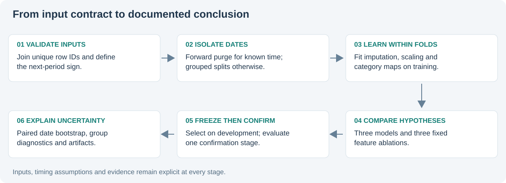

# Financial ML Validation

[Source repository](https://github.com/Mingju-Zhang-CBS/financial-ml-validation) · [Methods](https://github.com/Mingju-Zhang-CBS/financial-ml-validation/blob/main/docs/METHODS.md) · [Tests and offline demo](https://github.com/Mingju-Zhang-CBS/financial-ml-validation/actions/workflows/checks.yml)

**Question:** When can a financial classification score support a research conclusion?

## Contribution and skills

An independent Python study compares logistic regression, LightGBM and CatBoost across three fixed feature variants. It demonstrates financial-panel preparation, exact keyed joins, pipeline-based preprocessing, date-aware validation, model selection, diagnostics and uncertainty reporting.

## The recorded experiment

The synthetic panel contains 4,320 observations, 360 dates and 12 allocations. Three forward development folds use a 20-date purge; a separate 72-date confirmation stage follows development selection. Raw histories, summary statistics and allocation identity form the three ablations.

The selected logistic/identity model achieves **52.66% accuracy**, versus **49.31%** for the training-fitted majority baseline. The accuracy difference is **3.36 percentage points**, with a paired date-bootstrap interval of **[-2.08, 9.03]**. Log loss is worse than baseline.

## The research judgment

The apparent accuracy improvement remains uncertain, and probability quality is not improved by every measure. I retain that result rather than tuning confirmation until the narrative looks stronger. The study demonstrates a complete validation process; it does not establish investable alpha.

Its official-data adapter also distinguishes anonymous date groups from a known calendar. Previously inspected challenge labels do not become unseen data after reshuffling. Prediction vectors must align exactly: broadcasting and nonfinite probabilities are rejected before uncertainty is calculated.

## What to inspect in the standalone implementation

`data.py` defines schema, alignment and features. `research.py` implements folds, fold-fitted estimators, selection and the paired bootstrap. The CLI generates aggregate artifacts, while `examples/explain_validation.py` walks through alignment and a training fold. Behavioral tests exercise time boundaries, target aliases, invalid vector shapes, preprocessing scope and estimator integration.

[Recorded metrics](../assets/financial-ml-validation-metrics.json) · [Run manifest](../assets/financial-ml-validation-manifest.json)

The complete implementation is published in [`financial-ml-validation`](https://github.com/Mingju-Zhang-CBS/financial-ml-validation). Public snapshots use synthetic data. Development was AI-assisted; the original QRT task and estimator libraries retain attribution.
