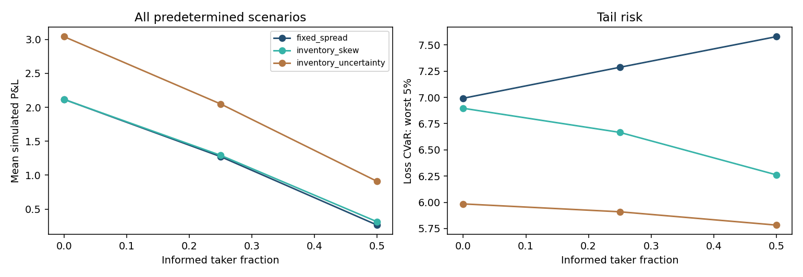

# Market Making Lab

**Runnable public demonstration.** [Source](https://github.com/Mingju-Zhang-CBS/market-making-lab) · [Methods](https://github.com/Mingju-Zhang-CBS/market-making-lab/blob/main/docs/METHODS.md) · [Walkthrough](https://github.com/Mingju-Zhang-CBS/market-making-lab/blob/main/docs/WALKTHROUGH.md) · [Complete report](https://github.com/Mingju-Zhang-CBS/market-making-lab/blob/main/reports/demo/REPORT.md)

**Question:** What changes when fair value becomes an affordable quote?

I connect backward dynamic programming to three inventory/collateral-aware policies across nine shared-path simulations. Every result can be traced through trade cash flows, markouts and settlement.

## Contribution and skills

Probability · market microstructure · inventory risk. This implementation, examples and reporting were independently written for the public portfolio with AI assistance. Original employer/contest sources are excluded.

## Read the evidence

Three policies and three flow assumptions use 1,000 common paths. The uninformed demand is price-inelastic, so wider spreads gain a mechanical advantage. Read that limitation before interpreting policy rankings.

[Metrics](../assets/market-making-lab-metrics.json) · [Manifest](../assets/market-making-lab-manifest.json)

## What to inspect

Start with the numerical walkthrough and the full report. Then inspect core.py and the behavioral tests in the source repository. The results are simulated, conditional on the declared configuration, and separate from previous professional experience.
