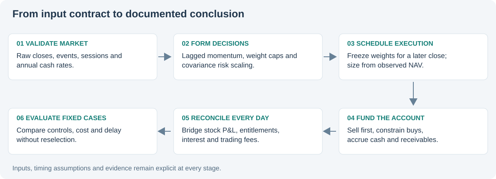
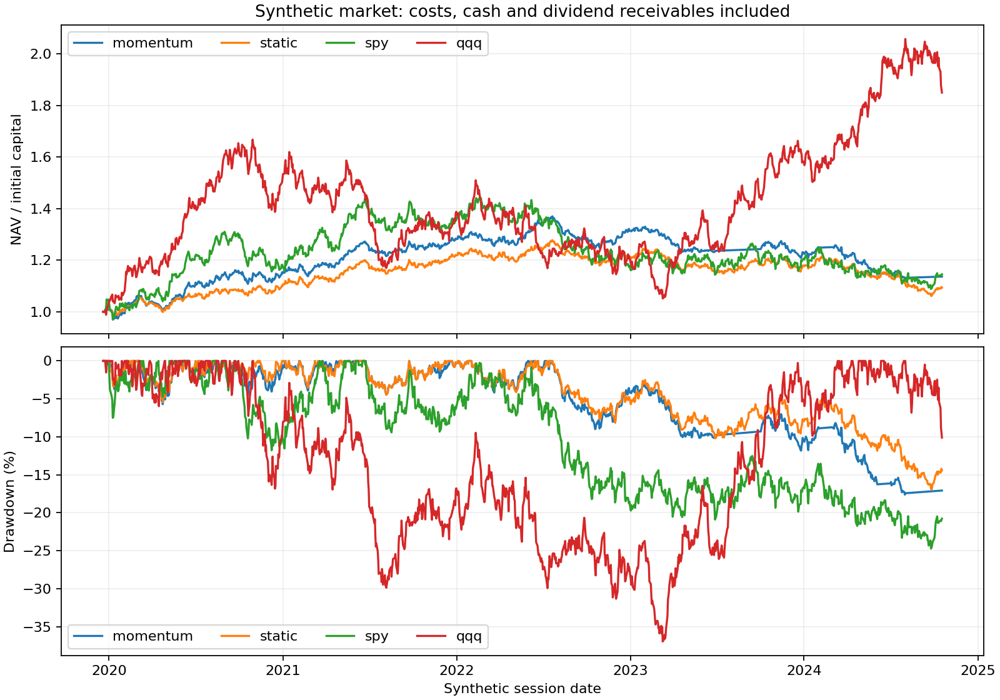

# Systematic Strategy Lab

[Source repository](https://github.com/Mingju-Zhang-CBS/systematic-strategy-lab) · [Methods](https://github.com/Mingju-Zhang-CBS/systematic-strategy-lab/blob/main/docs/METHODS.md) · [Tests and offline demo](https://github.com/Mingju-Zhang-CBS/systematic-strategy-lab/actions/workflows/checks.yml)

**Question:** What changes when a portfolio signal becomes a funded account?

## Contribution and skills

An independent long-only simulator connects fixed momentum decisions to later trades, constrained funding and daily P&L. It demonstrates systematic investment research, account modeling, corporate-action conventions, risk metrics and invariants that can be tested independently.

## The recorded experiment

Five asset roles are generated across 1,512 synthetic sessions. Momentum, static allocation and two passive controls share a 252-session warmup and account period. The four strategy runs produce 5,040 daily account rows. Costs and delay are examined through six fixed cases.

The maximum absolute daily NAV bridge error across the recorded controls is below 3e-11 currency units. Momentum's synthetic excess Sharpe is approximately 0.049, illustrating how a complete implementation can still yield a weak economic result in the chosen experiment.

## The mechanism that matters

A split changes share units. An ex-date dividend creates a receivable; payment later transfers it to cash without creating additional NAV. The account cannot spend an unpaid entitlement. Trades sell first and reduce purchases to available cash including fees. A decision uses current/past inputs and becomes eligible for execution at a later close.

The standalone worked example buys 990 shares at 100 with 1,000 cash. A 2-for-1 split and a dividend of 1 per new share leave 1,980 shares at 49, 1,980 receivable and unchanged NAV of 100,000. After payment, cash rises to 2,980 and receivable returns to zero. This small trace demonstrates an economic identity more directly than a performance curve alone.

## Research limits and implementation evidence

Synthetic ticker labels are not historical ETF returns. Next-close execution, payment lag and common sessions are explicit assumptions. The model does not establish fill capacity, and the controls have different exposures. The study reports every predetermined stress case without choosing a new strategy from the best row.

The standalone packet contains the account engine, a one-event example, per-strategy ledgers/decisions/orders and behavioral tests for future-price invariance, fees, no overdrafts and split/dividend wealth preservation.

[Recorded metrics](../assets/systematic-strategy-lab-metrics.json) · [Run manifest](../assets/systematic-strategy-lab-manifest.json)

The complete implementation is published in [`systematic-strategy-lab`](https://github.com/Mingju-Zhang-CBS/systematic-strategy-lab). Development was AI-assisted from public financial concepts; restricted original materials are outside the portfolio.
